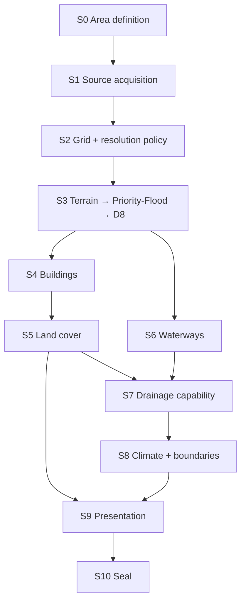

# Area preparation pipeline

**As at 26 November 2026. Specification — Increment A not yet implemented.**

This page specifies how an arbitrary study area becomes a testable sandbox: one
area definition goes in, one sealed bundle of artefacts comes out, and the
engine reads what that bundle says it may compute. It replaces the current
"HSK scripts" arrangement, in which every stage is shaped around one rectangle
and nothing records what a stage actually produced.

The output is a **broad-brush screening sandbox** with a declared capability
level per axis. It is not a certified hydraulic model and not a Drainage Impact
Assessment. Where the data cannot support an axis at the area's resolution, the
pipeline says so and the engine refuses to publish that number.

---

## 1. Why the current path cannot carry a second area

Four facts, each verifiable in the repository today:

| Where | What it fixes |
|---|---|
| [`scripts/tiles_to_rasters.py`](../backend/scripts/tiles_to_rasters.py) | `west, south, east, north = 113.9922, 22.4310, 113.9994, 22.4363` and `rows, cols = 117, 148` |
| [`scripts/build_landclass.py`](../backend/scripts/build_landclass.py) | `BBOX = (...)`, `ROWS, COLS = 117, 148` |
| [`app/services/sandbox_model.py`](../backend/app/services/sandbox_model.py) | `load_grids()` is `@lru_cache(maxsize=1)` and takes no argument; every artefact is named `*_hsk.npy` |
| [`app/services/run_service.py`](../backend/app/services/run_service.py) | `_grids()` caches one `Grids` keyed on `wetgrid_hsk.npy`'s mtime |

There is also a contract bug that shows why the arrangement is fragile. The
study-area file is documented as "the single source of truth for the bbox", and
it declares:

```json
"grid": { "resolution_m": 5, "rows": 740, "cols": 667 }
```

Every script builds **117 × 148**. Those are a 1 m grid and a 5 m grid over the
same 741 m × 589 m extent. Two files disagree about the shape of the analysis,
and no code notices. A pipeline whose first invariant is "one grid, named once"
cannot drift this way.

---

## 2. The contract

### 2.1 Area bundle layout

```
backend/data/areas/<area_id>/
  aoi.json                     # the area definition (S0 output, the only input)
  manifest.json                # the seal (S10 output; rewritten after every stage)
  grid.json                    # the analysis grid every raster shares
  raw/                         # untouched downloads, per provider
    open3dhk/  worldcover/  sentinel2/  overture/  osm/  dsd/
  sources.lock.json            # retrieval dates pinned for reproducibility
  dem.npy  dem.json
  flow_filled.npy  flow_raw.npy  flow_receiver.npy  flow_accum.npy
  landclass.npy  landcover.json
  buildings.geojson  buildings_meta.json
  waterways.npy  waterways.json
  drainage_capacity.npy  drainage.json
  climate.json  outlets.json
  overlays/  wetgrid.png  heatmap.png
  model/     tileset.json  *.b3dm
```

Two rules:

1. **No artefact path is guessed.** A stage writes its paths into the manifest,
   and a consumer reads them from there. A renamed file is a failed load with a
   named reason, never a silently different array.
2. **`aoi.json` is the only input to the pipeline.** Nothing else in the bundle
   is hand-edited.

### 2.2 `aoi.json`

```json
{
  "id": "hsk-ht-nda",
  "name": "Hung Shui Kiu / Ha Tsuen New Development Area",
  "geometry": { "type": "Polygon", "coordinates": [[[113.9922, 22.4310], "..."]] },
  "requestedResolutionM": null,
  "created": "2026-11-26",
  "provenance": {
    "method": "drawn | place search | gazetted boundary",
    "source": "…",
    "retrieved": "2026-11-26",
    "knownGaps": ["…"]
  }
}
```

`requestedResolutionM: null` means "apply the policy in §4". An explicit value
is honoured only if the resulting cell count fits the budget; otherwise the
request is **rejected**, not silently coarsened.

### 2.3 `manifest.json`

```json
{
  "schemaVersion": 1,
  "areaId": "hsk-ht-nda",
  "grid": { "rows": 117, "cols": 148, "resolutionM": 5.0,
            "bounds": [113.9922, 22.4310, 113.9994, 22.4363] },
  "stages": {
    "s03_terrain": {
      "status": "ok",
      "artefacts": ["dem.npy", "dem.json", "flow_receiver.npy"],
      "sources": [{ "provider": "csdi", "dataset": "open3dhk",
                    "url": "…", "retrieved": "2026-11-26",
                    "licence": "…", "checksum": "…" }],
      "gates": [{ "name": "nodataShare", "value": 0.0, "passed": true,
                  "note": "" }],
      "started": "…", "finished": "…", "note": ""
    }
  },
  "capabilities": {
    "drainage": { "level": "L2", "basis": "…", "limits": ["…"] }
  },
  "gaps": [{ "axis": "drainage", "reason": "no channel geometry in this area" }],
  "sealedAt": "…"
}
```

`status` is one of `pending | running | ok | degraded | stale | failed`.

- **`degraded`** — the stage produced a usable artefact and a gate did not pass.
  The artefact is kept, the limit is in `note`, and the capability level drops.
- **`stale`** — the artefact is usable but its source snapshot is older than the
  provider's update cadence (DSD releases quarterly). A stale bundle may be
  read; a claim that quotes its capacity must say so.
- **`failed`** — no artefact. Downstream stages do not run.

A stage is **usable** when its status is `ok`, `degraded` or `stale`.

---

## 3. Stages



| Stage | Inputs | Outputs | Gate → on failure |
|---|---|---|---|
| `s00_area` | polygon, name, resolution option | `aoi.json` | polygon valid, on land, within area cap → reject with the reason |
| `s01_sources` | CSDI, OSM, WorldCover, S2, Overture, Open3Dhk, HKO | `raw/*`, `sources.lock.json` | ≥ 1 source per required family → mark that family `unavailable` |
| `s02_grid` | `aoi.json` | `grid.json` | cells ≤ `MAX_CELLS` → coarsen and record `coarsenedFromM` |
| `s03_terrain` | Open3Dhk tiles, else Open-Meteo | `dem.npy`, `flow_*.npy` | nodata < 2% → nearest-fill and flag; coarse-only DEM caps terrain at L1 |
| `s04_buildings` | Overture + tile DSM | `buildings.geojson`, `buildings_meta.json` | count > 0 → massing-dependent axes become `unavailable` |
| `s05_landcover` | WorldCover, S2 NDVI/NDWI, tree mask, footprints | `landclass.npy` | no single class > 95% unless the area is genuinely that class → flag |
| `s06_waterways` | OSM Overpass, DSD Channel layer | `waterways.npy` | ≥ 1 path → drainage stays pipe-only, stated |
| `s07_drainage` | DSD pipes, manholes, culverts; channel geometry | `drainage_capacity.npy`, `drainage.json` | graph connectivity, slope > 0 → per-cell fallback to L1, never zero |
| `s08_climate` | HKO gauges, SDM tables | `climate.json`, `outlets.json` | ≥ 1 rainfall and 1 tide source → refuse the boundary condition |
| `s09_presentation` | all of the above | overlay PNGs, per-area `tileset.json` | tileset bbox equals grid bounds → do not advertise the layer |
| `s10_seal` | all stages | `manifest.json` | every stage has an explicit status → no stage may be absent |

`tiles_to_rasters.py`, `build_landclass.py`, `build_buildings.py`,
`make_wetgrid.py`, `make_waterway_mask.py` and the DSD fetch become the bodies
of stages `s03`–`s09`. They keep their physics; they stop carrying their own
bbox.

---

## 4. Resolution policy: a constant cell budget

Plateauing the cell count while coarsening the grid is the honest way to scale a
screening model. Memory and runtime stay flat, and the resolution loss is
recorded rather than absorbed.

| Area | Cell size | Cells | Drainage ceiling |
|---|---|---|---|
| ≤ 500 ha | 5 m | ≤ 200,000 | L2 |
| ≤ 2,500 ha | 10 m | ≤ 250,000 | L2 where each conduit's contributing area ≥ 1 cell, else L1 |
| ≤ 10,000 ha | 20 m | ≤ 250,000 | L1 |
| > 10,000 ha | refused | — | sub-basin decomposition is Increment D |

`MAX_CELLS = 250_000`, `MAX_AREA_HA = 10_000`. Above the budget the policy
doubles the cell size until the grid fits, and writes `coarsenedFromM` into
`grid.json` and the manifest. A caller who asked for 5 m and got 20 m is told.

**Resolution caps capability.** At 20 m a cell is 400 m², so a 300 mm pipe
serving 0.2 ha drains half a cell and per-conduit attribution is meaningless;
drainage therefore drops to the L1 published-standard proxy. This is a property
of the method, not a bug, and the pre-download preview states it.

---

## 5. Capability levels

| Level | Name | Basis | Permitted wording |
|---|---|---|---|
| L0 | unavailable | no data at this resolution | "not testable here", with the reason |
| L1 | published-standard proxy | SDM 2024, 134 mm/h | "screened against the DSD design standard" |
| L2 | public-asset derived | DSD conduits, Manning, bottleneck | "existing conduit capacity, X m³/s at outfall `FEAT_NUM`" |
| L3 | event-calibrated | replay of 2023-09-07 | "checked against one observed event" |
| — | certified | DIA-grade hydraulic model | never claimed |

The existing constant
[`DRAINAGE_STANDARD_MM_H = 134.0`](../backend/app/services/sandbox_model.py)
becomes the **L1 fallback**, not the only answer. The response reports the split
between the asset-derived share and the standard share of the area.

---

## 6. Code layout

```
backend/app/pipeline/
  area.py            # AreaRecord, resolution policy, grid derivation. Pure.
  manifest.py        # StageStatus, Gate, SourceRef, Capability, Manifest.
  runner.py          # Stage DAG, idempotent, resumable, seal.
  cache.py           # content-addressed source cache, shared across areas.
  sources/           # provider adapters (csdi, dsd, osm, worldcover,
                     # sentinel2, overture, open3dhk, hko).
  stages/            # s00_area … s10_seal
```

`area.py` and `manifest.py` import the standard library plus the metric
conversion in `app.services.geo_import` (and `app.config` for the data root), so
a stage can be unit-tested without numpy and a script can read a seal without
booting the service layer.

`scripts/prepare_area.py` is the only entry point:

```
python scripts/prepare_area.py --area hsk-ht-nda --preview
python scripts/prepare_area.py --area hsk-ht-nda
python scripts/prepare_area.py --area hsk-ht-nda --stage s07 --force
python scripts/prepare_area.py --area hsk-ht-nda --status
```

---

## 7. The loader seam

The single change the rest of the service layer needs:

```python
# today — one process can hold exactly one area
@lru_cache(maxsize=1)
def load_grids() -> Grids | None:
    rasters = settings.rasters_dir
    if not (rasters / "wetgrid_hsk.npy").exists():
        return None
```

```python
# after — area-keyed, and the artefacts are read from the seal
@lru_cache(maxsize=4)
def load_grids(area_id: str) -> Grids | None:
    bundle = AreaBundle(area_id)          # Manifest + bundle paths (Increment A)
    if not bundle.ready("s03_terrain"):
        return None
    return bundle.grids()
```

`_GRIDS_CACHE` becomes a dict keyed by `(area_id, manifest_mtime)`.
`run_service`, `comparison`, `board`, `storm_playback`, `siting` and
`government_fit` take the scene's `area_id` instead of the module global. No
physics changes.

---

## 8. API and the selection flow

| Route | Purpose |
|---|---|
| `POST /api/areas` | geometry + name + options → draft, returns the **preview** (area, resolution, cells, capability ceiling, cost class) computed before any download |
| `GET /api/areas/{id}` | area record and, when present, the seal |
| `POST /api/areas/{id}/prepare` | enqueue; returns a job id |
| `GET /api/areas/{id}/prepare` | per-stage progress read from `manifest.json`; a restart resumes at the first non-usable stage |
| `POST /api/areas/{id}/scene` | bind a scene to a sealed area; refuses when the seal is not ready |

Frontend flow: search a place or draw a rectangle/polygon over the Cesium globe
→ preview card → prepare → a ten-stage progress rail → open the sandbox.

The preview is the product moment. It tells a planner, before a long build, that
a 3,000 ha site at 10 m cannot attribute per-conduit capacity, and therefore
what the drainage row will and will not say.

---

## 9. Scaling rules

- **Shared source cache.** `data/cache/sources/<provider>/<dataset>/<key>`
  keyed by tile or `FEAT_NUM`. HSK, San Tin and Tin Shui Wai share one
  WorldCover tile set. `sources.lock.json` pins retrieval dates so a rebuild
  after a quarterly DSD refresh is still reproducible.
- **Sub-basin decomposition (Increment D).** Above the cell budget, compute
  catchments at 20 m, order them topologically, and pass
  `outflow_m3_per_hour` across each cut line as a boundary condition. This
  reuses the existing outlet concept (`receiver == -1`) rather than adding a
  second router.
- **Per-outlet tide.** `TIDE_STATES` is one scalar today. `outlets.json` carries
  the nearest gauge per outfall and the tailwater per boundary cell.
- **Coverage guard re-spec.** `MAX_INTERVENTION_COVERAGE = 0.25` is already
  flagged as the wrong instrument at district scale (`PLAN.md` §3.3, D3). It
  must be expressed against the plan footprint or sub-basin, not the whole area.
- **Per-area 3D Tiles.** Build a `tileset.json` per area so Cesium performs the
  LOD; never ship a merged mesh for a large area. Keep the flat
  `buildings.geojson` at analysis resolution only.
- **Jobs, not requests.** Progress is written into the manifest after every
  stage, so polling is trivial and a restart resumes. A single background worker
  is enough; swapping in a queue changes `runner.py` only.

---

## 10. Sequencing and acceptance

### Increment A — the seam, no new physics

Area record, bundle layout, seal, `prepare_area.py` wrapping the six existing
scripts unchanged, area-keyed loader, `scene.area_id`.

**Acceptance:** HSK is re-prepared into the new layout with byte-identical
`dem.npy`, `landclass.npy` and `wetgrid.npy`; every existing test passes; the
740 × 667 / 117 × 148 contradiction is gone because `grid.json` is the only
place the shape is written.

### Increment B — drainage becomes a real stage

CSDI adapter, Manning full-flow per conduit, downstream bottleneck, per-cell
`drainage_capacity.npy`, per-cell draining in `hourly_storm_simulation`, L1 → L2
where coverage allows.

**Acceptance:** the study window's 414 stormwater pipes, 279 manholes and 4 box
culverts produce a stated outfall capacity and a named limiting `FEAT_NUM`; the
134 mm/h proxy survives as the fallback; the response states the asset-derived
share.

### Increment C — a second area end to end

Draw or search → prepare → scene. Proves generality; the preview and capability
ceiling appear in the UI.

### Increment D — scale

Sub-basins, per-outlet tide, guard re-spec, per-area tilesets.

`STATUS.md` gains a row per capability as each stage lands. Nothing in this
document is claimed as built until it does.

---

## 11. Risks and unknowns

| Risk | Consequence | Handling |
|---|---|---|
| **Open3Dhk tile download for an arbitrary bbox is unproven.** Only six tiles are committed and there is no downloader in the repo. | Terrain falls back to the ~90 m Open-Meteo DEM; every new area starts at L1. | Probe this first. It is the largest unknown in the plan. |
| **DSD licensing.** The `hk-dsd-dsd_psi_1-drainage-record` package record carries `isopen: false` and no `license_id`. | Committing raw pipe geometry may not be permitted. | Commit the fetch script and a derived `drainage_capacity.npy` plus summary, not the raw dump, until the terms are confirmed. |
| **FeatureServer paging.** Every bbox query observed returned `exceededTransferLimit`. | A silently truncated layer understates capacity. | Paginate on `resultOffset`; assert the paged count equals `returnCountOnly`. |
| **Quarterly drift.** DSD updates quarterly. | A 2024 network presented as current. | `stale` seals are visible and any quoted capacity carries the snapshot date. |
| **Sentinel-2 volume.** A large area matches many items. | Slow, memory-heavy composites. | Median composite over a capped, date-filtered item set. |
| **Determinism.** Sources move under the build. | Two runs of the same area disagree. | `sources.lock.json` pins dates and checksums. |

---

## 12. Proposed ADRs

Not yet recorded in [`ADR.md`](ADR.md):

- **ADR-037 — One area, one bundle, one seal.** Every artefact path is read from
  the manifest; `aoi.json` is the sole input. Rejects the current arrangement
  where a script decides its own extent.
- **ADR-038 — Resolution is a budget, not a promise.** Cell count is capped and
  the resolution coarsens; a coarsened grid caps the capability level. A
  requested resolution that does not fit is rejected, never silently degraded.
